# Desafio: imite a emoção

Fecha a oficina usando a serial nos dois sentidos. A placa sorteia uma emoção e avisa a página; a página dá 3 segundos para a pessoa fazer a cara e responde se acertou.

## Regras e mensagens

1. Sacuda a placa: ela sorteia **feliz, triste, surpresa ou raiva**, mostra a carinha e manda `alvo:feliz`.
2. A página escreve `Imite: feliz 3`, `2`, `1` no canto da tela. São 90 quadros, uns 3 segundos (o `drawLoop` roda a uns 30 quadros por segundo; em máquina lenta demora um pouco mais).
3. No último quadro, a página compara com a emoção detectada e manda `acertou` ou `errou`.
4. A placa mostra ✓ e soma um ponto, ou ✗. O botão A mostra os pontos.

Só 4 emoções porque são as mais fáceis de fazer com o rosto; nojo e medo o modelo erra muito.

**Pronto quando**: sacudir, ver a contagem, fazer a cara certa e ver ✓; fazer outra cara e ver ✗.

## O caminho de volta

No passo 6 só a página falava. O mesmo cabo leva dados nos dois sentidos:

- na placa, o bloco **serial grava linha** (Avançado → Serial) manda o texto com um fim de linha;
- na página, `porta.readable` recebe, como `porta.writable` manda.

Para ver sem página nenhuma: no MakeCode, **Mostrar console do dispositivo** mostra o que a placa grava.

## A placa (blocos)

Arquivo: [microbit_imite_a_emocao.js](microbit_imite_a_emocao.js). No MakeCode, cole na aba JavaScript e volte para Blocos, ou monte os blocos.



- **Ao iniciar**: igual ao receptor do passo 6 (serial na USB, 115200, carinha dormindo).
- **em agitar**: o dado do teste 3, com 4 caminhos. Cada um define `alvo` e mostra a carinha; no fim, **serial grava linha** com **unir** (Texto) junta `alvo:` com a emoção.
- **serial nos dados recebidos**: `resposta` guarda a linha; `acertou` soma 1 em `pontos` e mostra ✓, `errou` mostra ✗. As palavras de emoção que a página continua mandando não entram em nenhum **se** e são ignoradas.
- **no botão A**: mostra `pontos`.

## A página (parte da LLM)

O código serial é a parte da LLM, como no passo 6. Prompt:

> Minha página (JavaScript, módulo ES) já tem: porta (Web Serial aberta a 115200), escritor (writer da porta), emocaoAtual (a palavra da emoção), lerEmocao() chamada umas 30 vezes por segundo e escrever(texto, linha), que escreve no canvas. Do jeito mais simples possível:
> 1. Uma função lerDoMicrobit() que lê porta.readable linha a linha e, quando chegar "alvo:feliz", guarda "feliz" em alvo e começa a contar 90 quadros.
> 2. Uma função jogar(), chamada no fim de lerEmocao(), que enquanto houver alvo desconta um quadro, escreve "Imite: feliz 3" (depois 2 e 1) na linha 4 e, no último quadro, manda "acertou" ou "errou" com \n pelo escritor e limpa o alvo.
> 3. Onde chamar lerDoMicrobit() depois de conectar, e como cancelar e soltar o leitor dentro de desconectar().

Versão de referência: [gabarito/piscadas.html](gabarito/piscadas.html) (o gabarito do passo 6 mais as linhas marcadas com `// DESAFIO`). Como os outros gabaritos, só roda copiado para `human/demo/video/`.

```js
let alvo = '';
let quadros = 0;
let leitor = null;

async function lerDoMicrobit() { // le o que a placa manda, linha por linha
  leitor = porta.readable.getReader();
  let texto = '';
  while (true) {
    const { value, done } = await leitor.read();
    if (done) break; // desconectou
    texto += new TextDecoder().decode(value);
    if (texto.includes('\n')) { // chegou a linha inteira
      const linha = texto.trim();
      texto = '';
      if (linha.startsWith('alvo:')) {
        alvo = linha.slice(5); // 'alvo:feliz' vira 'feliz'
        quadros = 90; // ~3 segundos a 30 quadros por segundo
      }
    }
  }
}

function jogar() { // chamada a cada quadro, depois de ler a emocao
  if (!alvo) return;
  quadros--;
  escrever(`Imite: ${alvo} ${Math.ceil(quadros / 30)}`, 4);
  if (quadros === 0) {
    const resposta = emocaoAtual === alvo ? 'acertou' : 'errou';
    escritor.write(new TextEncoder().encode(resposta + '\n'));
    alvo = '';
  }
}
```

E três linhas em lugares que já existem:

- `jogar();` no fim de `lerEmocao()`, depois de `enviarEmocao(emocaoAtual);`
- `lerDoMicrobit();` no `botao.onclick`, depois de `botao.textContent = 'micro:bit conectado';` (sem `await`: fica lendo em paralelo)
- `if (leitor) { await leitor.cancel(); leitor.releaseLock(); leitor = null; }` no começo do `try` de `desconectar()`

O que cada parte faz:

- `getReader()` pega o leitor da porta; `read()` devolve os bytes que chegaram (`done` fica `true` quando o leitor é cancelado).
- Os bytes chegam aos pedaços: o texto vai sendo juntado e só é usado quando aparece o `\n`. `trim()` tira o `\r` que o MakeCode põe antes do `\n`.
- O tempo é contado em quadros, sem relógio: `jogar()` roda uma vez por quadro, então 90 chamadas dão uns 3 segundos e `Math.ceil(quadros / 30)` mostra 3, 2, 1.

## Problemas comuns

- **Conectar de novo dá porta já aberta**: faltou cancelar e soltar o leitor no `desconectar()`.
- **A contagem não aparece**: a placa mandou mas a página não leu. Confira se `lerDoMicrobit()` é chamada depois de conectar e se o programa da placa é o deste desafio (o receptor do passo 6 não manda nada).
- **Sempre dá errou**: o alvo e a emoção têm que ser a mesma palavra, sem acento (`surpresa`, não `surprêsa`). A contagem também para quando o rosto sai da câmera, porque `lerEmocao()` só roda com rosto na tela.
- **A placa mostra a carinha da emoção em vez do alvo**: está gravado o receptor do passo 6, não o programa do desafio.
