# Passo 5 (dia 2): o micro:bit por dentro

Objetivo: entender o que é a placa e fazer três testes curtos com o que o passo 6 usa: a matriz de LED, eventos (botão, sensor), uma variável e o **se**. Os programas são em **blocos do MakeCode**; cada um também tem o JavaScript equivalente, que vira os mesmos blocos ao colar na aba JavaScript.

## O que é o micro:bit

Um computador de bolso numa placa só (*single board computer*): chips, sensores e saídas soldados juntos. É comum ouvir que o micro:bit "é um microcontrolador", mas a própria Micro:bit Educational Foundation descreve como uma placa que **contém** um microcontrolador e que, com botões e display, fica mais perto de um computador.

- **Chip principal (microcontrolador)**: processador, memória e entradas/saídas num chip só. É ele que roda o seu programa. Diferente do PC, não tem sistema operacional nem roda vários programas: roda **um programa só, para sempre, em laço**, lendo sensores (entradas) e mexendo em LEDs, som e pinos (saídas). É o mesmo modelo do `drawLoop` da página no passo 1.
- **Chip da USB**: um segundo chip, perto do conector, que não liga em nenhum sensor. Roda o DAPLink e cuida de três coisas: a unidade MICROBIT (arrastar o `.hex`), a serial entre PC e chip principal e a gravação pelo navegador. É ele que aparece como **BBC micro:bit CMSIS-DAP** no MakeCode. No passo 6, a palavra da emoção faz o caminho PC → USB → chip da USB → serial → chip principal → LEDs.

| | V1 | V2 |
|---|---|---|
| Chip principal | nRF51822, Cortex-M0, 16 MHz | nRF52833, Cortex-M4, 64 MHz |
| Memória para o programa (flash) | 256 KB | 512 KB |
| Memória de trabalho (RAM) | 16 KB | 128 KB |
| Chip da USB | KL26 | KL27 (V2.0) ou nRF52820/nRF52833 (V2.2x) |

Para comparar: um notebook com 8 GB tem 65.536 vezes a memória de trabalho do V2. A placa compensa fazendo uma coisa só.

Fontes: [What is a micro:bit?](https://support.microbit.org/support/solutions/articles/19000013983-what-is-a-micro-bit-) (Micro:bit Educational Foundation), [Hardware](https://tech.microbit.org/hardware/) e páginas de revisão [1.5](https://tech.microbit.org/hardware/1-5-revision/), [2.0](https://tech.microbit.org/hardware/2-0-revision/), [2.2x](https://tech.microbit.org/hardware/2-2-revision/), [DAPLink e a interface USB](https://tech.microbit.org/software/daplink-interface).

## A placa por fora

| Componente | Onde | V1 | V2 |
|---|---|---|---|
| Matriz de 25 LEDs (também mede luz) | frente | sim | sim |
| Botões A e B | frente | sim | sim |
| Logo dourado sensível ao toque | frente | não | sim |
| Microfone (furinho com LED ao lado do logo) | frente | não | sim |
| Acelerômetro e bússola | atrás | sim | sim |
| Sensor de temperatura (dentro do processador) | atrás | sim | sim |
| Alto-falante | atrás | não | sim |
| Rádio e Bluetooth (antena) | atrás | sim | sim |
| Pinos na borda (P0, P1, P2, 3V, GND e os finos) | embaixo | sim | sim |
| USB (energia, gravação e serial) e conector de bateria | em cima | sim | sim |

## Gravar no MakeCode

1. Ligue o micro:bit com um cabo micro USB **de dados**.
2. Abra <https://makecode.microbit.org> no **Chrome ou Edge** e crie um **Novo projeto**.
3. Vá na aba **JavaScript**, apague o que tiver e cole o programa. Volte para **Blocos** para ver em blocos.
4. Clique nos **"..."** ao lado de **Download** → **Conectar dispositivo** → **BBC micro:bit CMSIS-DAP**. Só precisa na primeira vez.
5. Clique em **Download**: grava direto pela USB.

**Não arraste o `.hex` para a unidade MICROBIT no Mac.** Esse caminho falha de forma aleatória no macOS: a placa cria um `FAIL.TXT` na unidade com `The transfer timed out` ou `Checksum calculation failure`. É um problema conhecido do macOS com a unidade do micro:bit desde o macOS 13 ([DAPLink #982](https://github.com/ARMmbed/DAPLink/issues/982)), não do programa nem da placa. No Windows e no Linux, baixar e arrastar também funciona.

Não precisa de extensão para nenhum teste: tudo vem no núcleo do MakeCode (rádio, música e serial incluídos).

## Teste 1: matriz de LED e botões

Arquivo: [makecode/teste1_matriz_botoes.js](makecode/teste1_matriz_botoes.js). Cole na aba JavaScript e volte para Blocos, ou monte os blocos.

- **O que é**: a matriz é uma tela de 25 pixels (5 × 5), como a imagem do dia 1; **mostrar ícone** acende um desenho pronto. **no botão A pressionado** é um evento: a placa roda os blocos de dentro quando o botão é apertado, como um `onclick` na página.
- **Na placa**: começa dormindo. A: feliz. B: triste. A+B: apaga.
- **Onde achar**: **Básico** (mostrar ícone, limpar tela), **Entrada** (no botão pressionado).
- **No passo 6**: as carinhas são as mesmas da emoção. Lá o evento deixa de ser o botão e passa a ser "chegou uma palavra pela serial".

## Teste 2: dado, com variável e evento de sensor

Arquivo: [makecode/teste2_dado.js](makecode/teste2_dado.js).

- **O que é**: **em agitar** é um evento de sensor: o acelerômetro percebe a sacudida e a placa roda os blocos de dentro. `numero` é uma variável: guarda o sorteio até o próximo.
- **Na placa**: sacuda e aparece um número de 1 a 6. Aperte A: o mesmo número de novo, porque a variável guardou.
- **Onde achar**: **Entrada** (em agitar, no botão), **Variáveis** (criar `numero`, definir), **Matemática** (escolher aleatório), **Básico** (mostrar número).
- **No passo 6**: o mesmo padrão. **serial nos dados recebidos** é o evento e `texto` é a variável que guarda a palavra.

## Teste 3: dado com faces, usando se

Arquivo: [makecode/teste3_dado_faces.js](makecode/teste3_dado_faces.js).

- **O que é**: **se** compara `numero` e roda só o caminho que deu certo; cada **senão se** é mais um caminho. **mostrar LEDs** desenha qualquer figura: é só clicar nos quadradinhos.
- **Na placa**: sacuda e aparece a face do dado sorteada.
- **Onde achar**: **Lógica** (se, `=`; o **⊕** embaixo do se cria cada senão se), **Básico** (mostrar LEDs).
- **No passo 6**: o receptor é este mesmo bloco, com `texto` no lugar de `numero`, as palavras no lugar de 1 a 6 e as carinhas no lugar das faces.

## Para ir além (fora da oficina)

Um programa para cada componente da placa, cada um com a imagem dos blocos. Não entram nos slides; servem para quem quiser explorar depois.

| Programa | Blocos | Componente | Na placa | Placa |
|---|---|---|---|---|
| [01_matriz_led.js](makecode/01_matriz_led.js) | [ver](blocos/01_matriz_led.svg) | matriz de LED | texto, coração e os 25 LEDs acendendo um a um (`led.plot(x, y)`) | V1 e V2 |
| [02_botoes.js](makecode/02_botoes.js) | [ver](blocos/02_botoes.svg) | botões | A soma 1, B zera, A+B mostra um coração | V1 e V2 |
| [03_acelerometro_dado.js](makecode/03_acelerometro_dado.js) | [ver](blocos/03_acelerometro_dado.svg) | acelerômetro | sacuda: aparece um número de 1 a 6 | V1 e V2 |
| [04_acelerometro_nivel.js](makecode/04_acelerometro_nivel.js) | [ver](blocos/04_acelerometro_nivel.svg) | acelerômetro | nível de bolha: o ponto escorrega para o lado mais baixo | V1 e V2 |
| [05_bussola.js](makecode/05_bussola.js) | [ver](blocos/05_bussola.svg) | bússola | mostra N, L, S ou O; na primeira vez pede calibração | V1 e V2 |
| [06_temperatura.js](makecode/06_temperatura.js) | [ver](blocos/06_temperatura.svg) | temperatura | botão A mostra a temperatura em graus | V1 e V2 |
| [07_luz.js](makecode/07_luz.js) | [ver](blocos/07_luz.svg) | luz | barra de luz; tampe a placa com a mão e veja baixar | V1 e V2 |
| [08_pinos.js](makecode/08_pinos.js) | [ver](blocos/08_pinos.svg) | pinos de toque | segure o GND e toque em P0, P1 ou P2 | V1 e V2 |
| [09_logo_toque.js](makecode/09_logo_toque.js) | [ver](blocos/09_logo_toque.svg) | logo de toque | encoste no logo: coração; solte: apaga | só V2 |
| [10_microfone.js](makecode/10_microfone.js) | [ver](blocos/10_microfone.svg) | microfone | barra de som; bata palma: carinha surpresa | só V2 |
| [11_som.js](makecode/11_som.js) | [ver](blocos/11_som.svg) | som | A toca uma escala, B um efeito de risada | V2 (no V1, só a escala, pelo pino 0) |
| [12_radio.js](makecode/12_radio.js) | [ver](blocos/12_radio.svg) | rádio | em dupla, mesmo grupo: A manda "oi", B manda "tchau" | V1 e V2 |
| [13_serial_grafico.js](makecode/13_serial_grafico.js) | [ver](blocos/13_serial_grafico.svg) | serial | "Mostrar console do dispositivo" no MakeCode: gráfico da inclinação | V1 e V2 |

As imagens dos blocos foram geradas pelo próprio MakeCode, a partir do JavaScript de cada arquivo, com o renderizador oficial ([Blocks embed](https://makecode.microbit.org/blocks-embed)).

## Carinhas prontas usadas no passo 6

`IconNames.Happy`, `Sad`, `Angry`, `Surprised`, `Confused`, `Silly`, `Meh`, `Asleep` (no MakeCode, bloco **mostrar ícone**). Teste trocando o ícone do botão A do teste 1 por cada uma (no bloco **mostrar ícone**, clique no desenho e escolha outro).

## Alternativa em MicroPython

Para quem usar o <https://python.microbit.org> em vez do MakeCode (aí não tem blocos), os programas desta pasta em Python cobrem parte dos componentes:

| Arquivo | Mostra |
|---|---|
| [01_ola.py](01_ola.py) | texto rolando e imagens prontas |
| [02_botoes.py](02_botoes.py) | carinha feliz no A, triste no B, coração nos dois |
| [03_sensores.py](03_sensores.py) | sacudir vira dado, A mostra temperatura, B mostra luz |
| [04_print_serial.py](04_print_serial.py) | manda dados para o PC pelo USB (**Show serial** no editor) |
| [05_som_v2.py](05_som_v2.py) | **só V2**: sons, toque no logo, palma |

No python.microbit.org, grave com **Send to micro:bit**. Documentação da API: <https://microbit-micropython.readthedocs.io/en/v2-docs/>.
