# Passo 6: mostrar a emoção na matriz de LED do micro:bit

Objetivo: tirar a informação da tela do PC e levar para o mundo físico. A página detecta a emoção (passo 4) e manda a palavra pelo cabo USB; o micro:bit recebe e desenha a carinha correspondente.

Este é o único passo em que usamos LLM: o código de comunicação serial dos dois lados é algo que qualquer LLM gratuita gera em segundos. Os arquivos desta pasta são a versão de referência, para comparar ou usar se o código gerado não funcionar.

## Peças

| Lado | Arquivo | Tecnologia |
|---|---|---|
| PC (navegador) | `human/demo/video/piscadas.html` (gabarito: [gabarito/piscadas.html](gabarito/piscadas.html)) | **Web Serial API** do Chrome/Edge |
| micro:bit (MakeCode, caminho da oficina) | [microbit_receptor_makecode.js](microbit_receptor_makecode.js), em blocos: [blocos/receptor_makecode.svg](blocos/receptor_makecode.svg) | MakeCode, blocos de `serial` |
| micro:bit (python.microbit.org, alternativa) | [microbit_receptor.py](microbit_receptor.py) | MicroPython, módulo `uart` |

Documentação:

- Web Serial: <https://developer.mozilla.org/en-US/docs/Web/API/Web_Serial_API>
- Serial no MakeCode: <https://makecode.microbit.org/reference/serial>
- UART do micro:bit (MicroPython): <https://microbit-micropython.readthedocs.io/en/v2-docs/uart.html>

## O protocolo

Combinamos o formato mais simples possível: **uma palavra por linha**, terminada em `\n`, a 115200 bauds (bits por segundo; os dois lados precisam usar o mesmo valor).

```
feliz\n
triste\n
surpresa\n
```

É como um `stdin` lido linha a linha. A página só envia quando a emoção **muda**, para não mandar a mesma palavra 30 vezes por segundo.

No micro:bit, os bytes chegam aos pedaços. No MakeCode, o bloco **serial nos dados recebidos (nova linha)** já espera o `\n` e entrega a linha inteira. No MicroPython o receptor junta tudo num `buffer` e só processa quando encontra um `\n`, igual a ler um stream de rede.

| palavra recebida | ícone no MakeCode | imagem no MicroPython |
|---|---|---|
| `feliz` | `IconNames.Happy` | `Image.HAPPY` |
| `triste` | `IconNames.Sad` | `Image.SAD` |
| `raiva` | `IconNames.Angry` | `Image.ANGRY` |
| `surpresa` | `IconNames.Surprised` | `Image.SURPRISED` |
| `medo` | `IconNames.Confused` | `Image.CONFUSED` |
| `nojo` | `IconNames.Silly` | `Image.SILLY` |
| `neutro` | `IconNames.Meh` | `Image.MEH` |
| (esperando) | `IconNames.Asleep` | `Image.ASLEEP` |

## Prompt sugerido para a LLM

Qualquer LLM gratuita serve. Algo como:

> Tenho uma página web em JavaScript (módulo ES) com uma variável `emocaoAtual` que contém uma palavra em português sem acento (feliz, triste, raiva, surpresa, medo, nojo, neutro) e uma função `lerEmocao()` chamada umas 30 vezes por segundo.
> 1. Escreva o código JavaScript que, ao clicar num botão com id `conectar`, usa a Web Serial API para abrir a porta de um BBC micro:bit (filtro `usbVendorId: 0x0d28`) a 115200 baud, e uma função `enviarEmocao(emocao)` que manda a palavra seguida de `\n`, só quando ela mudar. Trate erro de desconexão.
> 2. Escreva o programa em JavaScript do MakeCode (makecode.microbit.org) para o micro:bit, só com comandos que tenham bloco (sem `.trim()`), que lê essas linhas com `serial.onDataReceived` e `serial.readLine()` a 115200 e mostra com `basic.showIcon`: `IconNames.Happy` para feliz, `IconNames.Sad` para triste, `IconNames.Angry` para raiva, `IconNames.Surprised` para surpresa, `IconNames.Confused` para medo, `IconNames.Silly` para nojo, `IconNames.Meh` para neutro, e `IconNames.Asleep` enquanto não chega nada.

A resposta do item 2 vai na aba JavaScript do MakeCode; voltando para Blocos, ela vira blocos. Se aparecer um bloco cinza, a LLM usou algo que não tem bloco (como `.trim()`): use a versão pronta.

Para a alternativa em MicroPython, troque o item 2 por:

> 2. Escreva um programa MicroPython para o micro:bit (compatível com V1 e V2) que lê essas linhas pela UART da USB a 115200 e mostra `Image.HAPPY` para feliz, `Image.SAD` para triste, `Image.ANGRY` para raiva, `Image.SURPRISED` para surpresa, `Image.CONFUSED` para medo, `Image.SILLY` para nojo, `Image.MEH` para neutro, e `Image.ASLEEP` enquanto não chega nada.

## Fazer

### Parte A: micro:bit, no MakeCode

São os mesmos blocos dos slides. Dá para montar arrastando do menu ou colar o JavaScript.

1. Abra <https://makecode.microbit.org> e crie um **Novo projeto**.
2. Monte os 3 trechos abaixo, ou vá na aba **JavaScript**, apague o que tiver, cole [microbit_receptor_makecode.js](microbit_receptor_makecode.js) e volte para **Blocos**.
3. Grave pela USB: **"..." ao lado de Download → Conectar dispositivo → BBC micro:bit CMSIS-DAP**, depois **Download**. No macOS não baixe e arraste o `.hex` (ver o passo 5).
4. A matriz mostra a carinha dormindo.
5. **Feche a aba do MakeCode** (ou desconecte a placa no menu dele): enquanto ele estiver conectado, segura a porta USB e a nossa página não consegue abrir.

Os blocos de serial ficam em **Avançado → Serial** e não precisam de extensão.

1. **Ligar a serial**, dentro do **Ao iniciar**: redireciona a serial para a USB, define 115200 (a velocidade da página) e mostra a carinha dormindo enquanto espera.

   

2. **Ler a palavra**: **serial nos dados recebidos (nova linha)** é um evento, como o **no botão** do passo 5. Roda a cada `\n` que chega. **definir texto para serial ler linha** guarda a palavra (sem o `\n`) na variável `texto`, e o **se** compara com cada palavra e mostra a carinha. O **⊕** embaixo do **se** cria cada **senão se**.
3. **As 7 emoções**: o bloco inteiro, com os 7 **senão se**:

   

Não usamos `.trim()` depois do `serial.readLine()`: no MakeCode ele não tem bloco e apareceria como um bloco cinza de JavaScript. A nossa página manda só `\n`, sem `\r`, então não faz falta.

#### Alternativa: MicroPython (python.microbit.org)

1. Abra <https://python.microbit.org>, cole o programa do micro:bit (o gerado pela LLM com o item 2 em MicroPython, ou [microbit_receptor.py](microbit_receptor.py)) e grave na placa com **Send to micro:bit** (pela USB).
2. A matriz deve mostrar a carinha dormindo (`Image.ASLEEP`).
3. **Feche a aba do python.microbit.org**: ela também segura a porta USB.

O receptor em MicroPython tem três trechos:

1. **As carinhas**: o dicionário `IMAGENS` liga cada palavra que a página manda a uma imagem pronta do micro:bit. Palavra que não está nele é ignorada.
   ```python
   IMAGENS = {"feliz": Image.HAPPY, "triste": Image.SAD, ...}
   ```
2. **Ligar a serial**: `uart.init(baudrate=115200)` casa a velocidade com a da página (`uart.init()` sem argumento usaria 9600). Sem `tx`/`rx`, ela usa os pinos ligados à USB. A carinha dormindo indica que está esperando, e `buffer` guarda os bytes que chegaram e ainda não formam uma linha.
   ```python
   uart.init(baudrate=115200)
   display.show(Image.ASLEEP)
   buffer = b""
   ```
3. **Ler linha por linha**: os bytes chegam aos pedaços. O laço junta tudo no `buffer`, procura o `\n`, recorta a linha, converte para texto com `str(linha, "utf-8").strip()` (o `strip` tira um `\r` se vier) e mostra a carinha. O `while` de dentro existe porque podem ter chegado duas linhas de uma vez.
   ```python
   while True:
       if uart.any():
           dados = uart.read()
           ...
           fim = buffer.find(b"\n")
   ```

### Parte B: página

Continuamos editando `human/demo/video/piscadas.html` do jeito que ficou no fim do passo 4 (113 linhas). Se perdeu, copie `../passo_4_emocoes/gabarito/piscadas.html` para lá. Edições de baixo para cima:

**1. Linha 86** (a `}` que fecha `lerEmocao`): depois dela e da linha em branco seguinte, cole o código serial (o gerado pela LLM ou este):

```js
      // OFICINA: envio pela serial (trecho gerado com LLM na oficina)
      const botao = document.getElementById('conectar');
      let porta = null; // porta serial aberta
      let escritor = null; // writer da porta, por onde mandamos bytes
      let ultimaEnviada = '';

      async function desconectar() { // solta o writer e fecha a porta, se estiverem abertos
        try {
          if (escritor) escritor.releaseLock();
          if (porta) await porta.close();
        } catch (erro) {
          // a porta ja estava fechada (ex.: cabo tirado): nada a fazer
        }
        porta = null;
        escritor = null;
      }

      botao.onclick = async () => {
        if (!('serial' in navigator)) {
          botao.textContent = 'Use Chrome ou Edge (sem Web Serial)';
          return;
        }
        await desconectar(); // clicar de novo reconecta do zero
        try {
          porta = await navigator.serial.requestPort({ filters: [{ usbVendorId: 0x0d28 }] }); // 0x0d28 = interface USB do micro:bit
          await porta.open({ baudRate: 115200 });
          escritor = porta.writable.getWriter();
          ultimaEnviada = '';
          botao.textContent = 'micro:bit conectado';
        } catch (erro) {
          await desconectar();
          botao.textContent = 'Falhou: ' + erro.message;
        }
      };

      async function enviarEmocao(emocao) {
        if (!escritor || emocao === ultimaEnviada) return; // so envia quando muda
        ultimaEnviada = emocao;
        try {
          await escritor.write(new TextEncoder().encode(emocao + '\n'));
        } catch (erro) {
          await desconectar();
          botao.textContent = 'Desconectou, clique para conectar';
        }
      }

```

**2. Linha 85** (`escrever(\`Emoção: ${emocaoAtual}\`, 3);`): depois dela, adicione:

```js
        enviarEmocao(emocaoAtual);
```

**3. Linha 17** (`<canvas id="canvas" ...>`): depois dela, adicione o botão:

```html
    <button id="conectar" style="position: fixed; top: 12px; right: 12px; font-size: 20px; padding: 8px 16px">Conectar micro:bit</button>
```

**4. Salvar e recarregar** <http://localhost:3000/demo/video/piscadas.html> (ou a porta que o terminal do servidor mostrar).

Entre a edição 1 e a 3, a página fica quebrada: o código procura o botão `conectar`, que só entra na edição 3. É o mesmo efeito das edições de baixo para cima dos passos 2 e 3.

O que o código da página faz:

- `navigator.serial.requestPort(...)`: abre a janela do navegador para o usuário escolher a porta. Só pode ser chamado a partir de um clique (regra de segurança do navegador), por isso existe o botão. O filtro `usbVendorId: 0x0d28` mostra só o micro:bit na lista (0x0d28 é o identificador do fabricante da interface USB da placa).
- `porta.open({ baudRate: 115200 })`: mesma velocidade do `uart.init` do micro:bit.
- `porta.writable.getWriter()`: a porta é um stream; o writer é por onde mandamos bytes.
- `desconectar()`: solta o writer e fecha a porta. É chamada antes de cada conexão e quando o envio falha, para que clicar em Conectar de novo (ou reconectar depois de tirar o cabo) não dê `The port is already open`.
- `new TextEncoder().encode(...)`: converte a string JavaScript em bytes UTF-8.
- `ultimaEnviada`: guarda a última palavra para só enviar quando mudar.

## O que deve aparecer

- Antes de conectar: a matriz mostra a carinha dormindo e a página mostra Piscadas, Razão e Emoção como no passo 4, com o botão **Conectar micro:bit** no canto de cima.
- Depois de conectar: o botão diz **micro:bit conectado** e a matriz troca de carinha cada vez que a emoção na tela muda.

## Testar

1. Clique em **Conectar micro:bit** no canto de cima da página.
2. Escolha o micro:bit na janela e clique em **Conectar**. O botão muda para "micro:bit conectado".
3. Faça caretas. A matriz troca a carinha junto com a emoção mostrada na tela.

## Conferir: diff contra o fim do passo 4

```diff
--- piscadas.html (fim do passo 4)
+++ piscadas.html (fim do passo 6)
@@ -15,6 +15,7 @@
   </head>
   <body>
     <canvas id="canvas" style="margin: 0 auto; width: 100%"></canvas>
+    <button id="conectar" style="position: fixed; top: 12px; right: 12px; font-size: 20px; padding: 8px 16px">Conectar micro:bit</button>
     <pre id="log" style="padding: 8px; position: fixed; bottom: 0"></pre>
     <script type="module">
       import * as H from '../../dist/human.esm.js'; // equivalent of import @vladmandic/Human
@@ -83,8 +84,55 @@
         if (!rosto || !rosto.emotion || rosto.emotion.length === 0) return;
         emocaoAtual = EMOCOES[rosto.emotion[0].emotion]; // a lista vem ordenada, maior score primeiro
         escrever(`Emoção: ${emocaoAtual}`, 3);
+        enviarEmocao(emocaoAtual);
       }
 
+      // OFICINA: envio pela serial (trecho gerado com LLM na oficina)
+      const botao = document.getElementById('conectar');
+      let porta = null; // porta serial aberta
+      let escritor = null; // writer da porta, por onde mandamos bytes
+      let ultimaEnviada = '';
+
+      async function desconectar() { // solta o writer e fecha a porta, se estiverem abertos
+        try {
+          if (escritor) escritor.releaseLock();
+          if (porta) await porta.close();
+        } catch (erro) {
+          // a porta ja estava fechada (ex.: cabo tirado): nada a fazer
+        }
+        porta = null;
+        escritor = null;
+      }
+
+      botao.onclick = async () => {
+        if (!('serial' in navigator)) {
+          botao.textContent = 'Use Chrome ou Edge (sem Web Serial)';
+          return;
+        }
+        await desconectar(); // clicar de novo reconecta do zero
+        try {
+          porta = await navigator.serial.requestPort({ filters: [{ usbVendorId: 0x0d28 }] }); // 0x0d28 = interface USB do micro:bit
+          await porta.open({ baudRate: 115200 });
+          escritor = porta.writable.getWriter();
+          ultimaEnviada = '';
+          botao.textContent = 'micro:bit conectado';
+        } catch (erro) {
+          await desconectar();
+          botao.textContent = 'Falhou: ' + erro.message;
+        }
+      };
+
+      async function enviarEmocao(emocao) {
+        if (!escritor || emocao === ultimaEnviada) return; // so envia quando muda
+        ultimaEnviada = emocao;
+        try {
+          await escritor.write(new TextEncoder().encode(emocao + '\n'));
+        } catch (erro) {
+          await desconectar();
+          botao.textContent = 'Desconectou, clique para conectar';
+        }
+      }
+
       async function drawLoop() { // main screen refresh loop
         const interpolated = human.next(); // get smoothened result using last-known results which are continously updated based on input webcam video
         human.draw.canvas(human.webcam.element, canvas); // draw webcam video to screen canvas // better than using procesed image as this loop happens faster than processing loop
```

## Problemas comuns

- **A unidade MICROBIT mostra `FAIL.TXT`** (`The transfer timed out` ou `Checksum calculation failure`): a gravação por cópia do `.hex` falhou, comum no macOS. Tire e recoloque o cabo e grave pela USB (**Conectar dispositivo** no MakeCode, ou **Send to micro:bit** no python.microbit.org).
- **A janela de escolha vem vazia**: cabo só de carga (troque por um de dados) ou micro:bit não reconhecido. Conferir se a unidade MICROBIT aparece no sistema.
- **"Falhou: Failed to open serial port"**: outra coisa está usando a porta. Feche a aba do MakeCode ou do python.microbit.org (o "Conectar dispositivo" dele segura a placa), monitores serial (Arduino IDE, PuTTY, `screen`) e outras abas com a página.
- **Linux, falha ao abrir mesmo com tudo fechado**: o usuário precisa de permissão na porta serial. `sudo usermod -aG dialout $USER`, depois sair e entrar de novo na sessão.
- **Botão diz "Use Chrome ou Edge"**: Firefox e Safari não têm Web Serial.
- **Matriz continua dormindo**: conferir se os dois lados estão em 115200, se a página manda `\n` no fim (e não `\r\n`: o receptor do MakeCode compara a linha sem tirar o `\r`) e se as palavras são as mesmas dos dois lados (sem acento).
- **A carinha fica piscando entre duas emoções**: o modelo oscila quando a expressão está no meio-termo. Fica como desafio abaixo.

## Desafios

- Só enviar a emoção depois que ela se repetir em, por exemplo, 10 leituras seguidas (filtra a oscilação).
- Mandar também as piscadas (ex.: linha `piscou`) e fazer o micro:bit mostrar `IconNames.Yes` por meio segundo.
- Caminho de volta: o desafio de fechamento, **imite a emoção**, está em [desafio_imite_a_emocao/](../desafio_imite_a_emocao/). Outra ideia curta: apertar o botão A do micro:bit e a página zerar o contador de piscadas (o micro:bit usa **serial grava linha** "zerar", a página lê com `porta.readable`).
